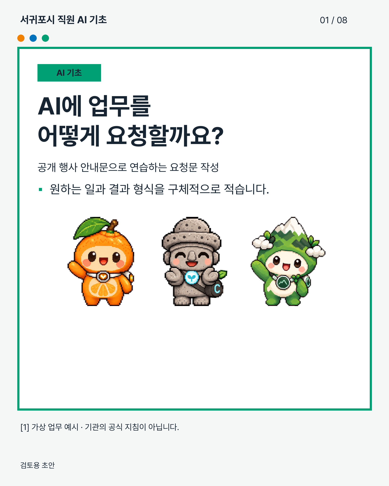
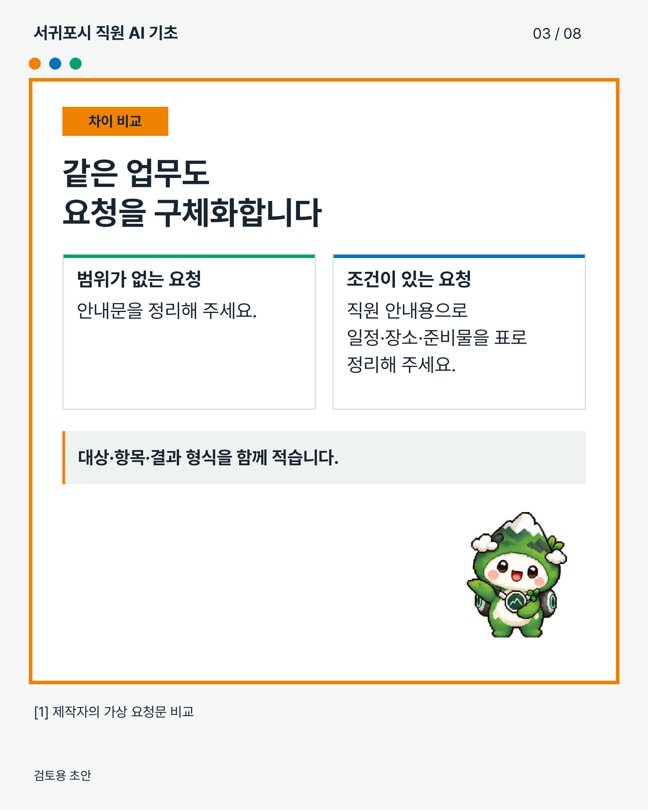

# 서귀포시 직원용 AI 카드뉴스 생성 스킬

서귀포시 직원에게 AI 지식을 쉽게 설명하는 Codex 스킬 **Jeju_Cardmaker v1.3.2**입니다. 한 편에 개념 하나와 업무 예시를 담고, 제주 펫 **귤귤·하르방·한라**로 학습 내용을 안내합니다.

## 기본 디자인

- Pretendard Regular 본문, Pretendard Bold 제목과 핵심 정리
- 제주그린 `#00A074`, 제주블루 `#0173BC`, 제주오렌지 `#F18101` 테두리
- 테두리 상자 바깥 왼쪽 위에 오렌지·블루·그린 원 3개 배치, 하단 3색 띠 제거
- 사각형 분류 라벨의 가로·세로 가운데 정렬, 본문 다음에 요약 배치
- 밝은 바탕과 짙은 본문 글자, 캐릭터와 문안 영역 분리
- 표지와 마지막 장에 세 캐릭터 모두 배치, 중간 장은 순환 배치
- 원본 애니메이션 시트에서 추출한 캐릭터별 7개 동작 포즈, 총 21개 투명 PNG 사용
- 글자와 상자를 피해 제목 옆·본문 옆·요약 아래 등 남은 여백에 캐릭터 배치
- 정의·비교·업무 활용·실행 예시·확인 방법·주의사항·요약 구성
- 기본 2160×2700 PNG·JPEG, 편집형/이미지형 PPTX, HTML, ZIP 출력

캐릭터는 [제주 펫 저장소](https://gitlab.aigov.go.kr/memory365/codex-pet-3jeju)의 원본 PNG를 포함합니다. 생성 시 외부 이미지 다운로드나 AI API 호출이 필요하지 않습니다. 원본 커밋과 해시는 [캐릭터 출처](Jeju_Cardmaker/assets/jeju-pets/SOURCES.md)에 기록했습니다.

## 출력 예시

가상 업무로 만든 검토용 초안입니다.

[캐릭터 동작 포즈 21종](docs/pet-poses.html)은 인사·걷기·설명·생각·기쁨·주의 동작을 표시하는 정지 PNG입니다. 카드 용도에 따라 포즈를 자동 선택합니다.

 

## 설치

1. 이 저장소를 ZIP으로 내려받아 압축을 풉니다.
2. 처음 설치는 INSTALL.cmd, 기존 설치본 교체는 UPDATE.cmd를 실행합니다. 기존 설치본은 백업합니다.
3. [Pretendard 공식 배포본](https://github.com/orioncactus/pretendard/releases)의 정적 Regular/Bold 폰트를 설치합니다.
4. Codex의 새 대화에서 `$Jeju_Cardmaker`를 호출합니다.

Python 3.11 이상과 렌더링 패키지가 필요합니다. 설치 위치는 `%USERPROFILE%\.agents\skills\Jeju_Cardmaker`입니다. 기본 템플릿은 Pretendard를 찾지 못하면 다른 글꼴로 대체하지 않고 필요한 설치나 경로 지정을 안내합니다. 편집형 PPTX를 여는 PC에도 Pretendard가 필요합니다.

이 저장소에 없는 사용자 수정본은 업데이트 전에 별도로 확인하세요. UPDATE.cmd는 기존 폴더를 백업한 뒤 저장소의 스킬로 교체하며 사용자 수정 사항을 자동 병합하지 않습니다.

## 사용 예

```text
$Jeju_Cardmaker
서귀포시 직원에게 AI 요청문 작성을 설명하는 카드뉴스 8장 초안을 만들어줘.
낯선 용어는 풀어 쓰고, 공개자료를 활용한 업무 예시를 넣어줘.
제주 펫 3종, Pretendard, 제주그린·블루·오렌지 테두리를 사용해줘.
각 장의 근거를 확인하고 PNG·JPEG·편집형 PPTX·ZIP으로 만들어줘.
```

기본 build 프로필은 `seogwipo-ai`입니다. 기존 일반 안내문 디자인은 `--profile jeju`, 중립 디자인은 `--profile neutral`로 선택합니다. 기존 render/package 명령도 유지합니다.

```text
python Jeju_Cardmaker/scripts/Jeju_Cardmaker.py build --project Jeju_Cardmaker/assets/seogwipo-ai-example --out output-example --preset portrait
python Jeju_Cardmaker/scripts/Jeju_Cardmaker.py verify-build --run output-example
```

예제는 디자인·기능 검수용 가상 업무 자료입니다. 실제 교육 원고는 주제에 맞는 공식 자료를 확인하고 문안을 검토해야 합니다. 자동 검사는 글자 영역과 출처 번호 연결 등을 검사하며 사실 확인이나 게시 승인을 대신하지 않습니다. SNS에 자동 게시하지 않습니다.

## 문서

- [직원 AI 학습 기획·디자인·입력 기준](Jeju_Cardmaker/references/seogwipo-ai.md)
- [8장 예제 기획안](Jeju_Cardmaker/assets/seogwipo-ai-example/plan.json)
- [설치와 출력 안내](README.KO.md)
- [명령 옵션](Jeju_Cardmaker/references/commands-v1.1.md)
- [변경 이력](CHANGELOG.md), [배포 범위](NOTICE.md)

문안과 캐릭터는 로컬에서 합성합니다. 스캔 문서 OCR, 구형 HWP, 생성형 그림 제작은 포함하지 않습니다. 폰트 파일은 배포하거나 PPTX에 포함하지 않습니다. 배포 파일 확인은 `python verify_package.py`로 실행합니다.
